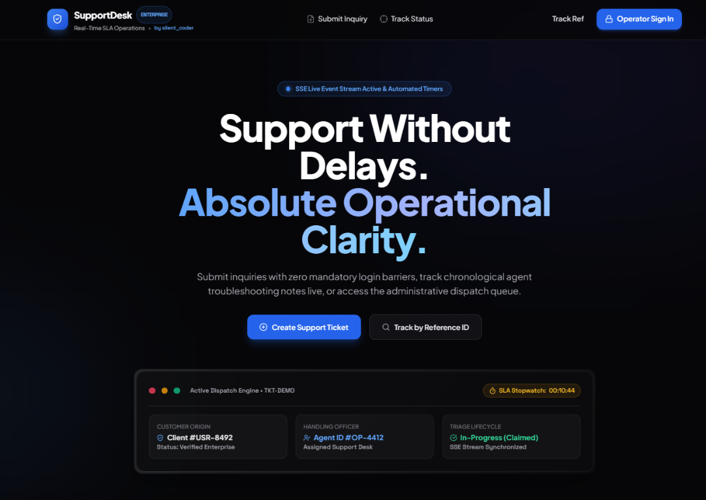
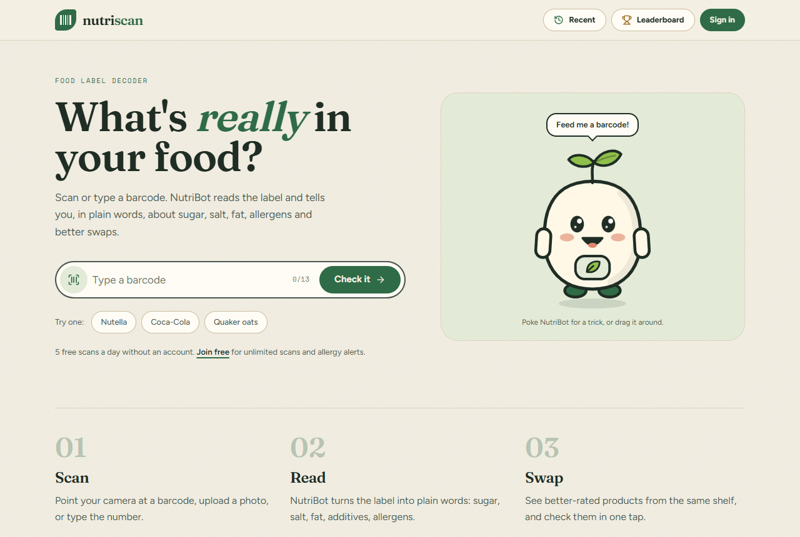
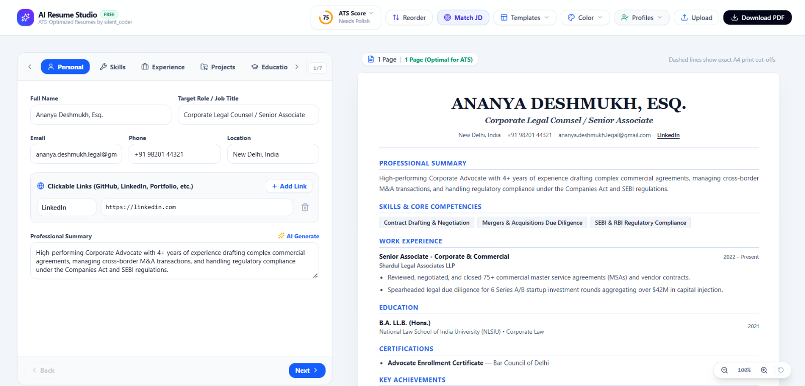

<div align="center">

# Satyam Singh
### Java & Spring Boot developer · Mumbai

**My personal site: the projects I've built, what I work with, and how to reach me.**

[](https://silently-code.vercel.app/)
[](https://react.dev/)
[](https://vite.dev/)
[](https://tailwindcss.com/)
[](https://www.framer.com/motion/)

<br />

<a href="https://support-desk-crm-qs00.onrender.com/">
  
</a>
<a href="https://nutriscan-web-pi.vercel.app/">
  
</a>

<br />

<a href="https://ai-resume-builder-silent.vercel.app/">
  
</a>

</div>

---

## Contents

- [Overview](#overview)
- [Featured projects](#featured-projects)
- [What's on the site](#whats-on-the-site)
- [Technology](#technology)
- [Run locally](#run-locally)
- [Project structure](#project-structure)
- [Editing content](#editing-content)
- [Deployment](#deployment)
- [Connect](#connect)

## Overview

I'm a Computer Engineering graduate (University of Mumbai, 2026) looking for a backend / Java developer role. Most of my work is in Java and Spring Boot, and I also vibe code: building with AI tools, then reviewing and fixing what they write. This repo is the single-page React site at [silently-code.vercel.app](https://silently-code.vercel.app/). It covers my projects, my vibe-coded work, stack, education and certifications, and has a contact form.

## Featured projects

| Project | What it is | Built with | Links |
| --- | --- | --- | --- |
| **SupportDesk** | Support ticketing CRM: a public customer portal, a live agent queue (SSE), and optimistic locking so two agents can't overwrite each other. | Java 21, Spring Boot 3, Spring Security, JPA/Hibernate, MySQL, Docker | [Live](https://support-desk-crm-qs00.onrender.com/) · [Source](https://github.com/silent-coder-dev/support-desk-crm) |
| **NutriScan** | Scan a food barcode and get a plain-English verdict, allergy and diet alerts, a veg / non-veg mark and better-rated swaps. | Spring Boot 4, PostgreSQL, Redis, JWT, Next.js, TypeScript | [Live](https://nutriscan-web-pi.vercel.app/) · [Source](https://github.com/silent-coder-dev/nutriscan) |
| **AI Resume Studio** *(vibe coded)* | Resume editor with live A4 preview, 11 templates, PDF export and AI proofreading / job-description matching. | Next.js, TypeScript, Zustand, Gemini / OpenRouter | [Live](https://ai-resume-builder-silent.vercel.app/) · [Source](https://github.com/silent-coder-dev/ai-resume-builder) |

> [!NOTE]
> SupportDesk runs on Render's free tier, so the first request can take up to a minute while the server wakes up.

## What's on the site

| Area | Details |
| --- | --- |
| **Hero** | An interactive dot field drawn on `<canvas>`: a perspective grid with a slow swell, a lens that follows the cursor, and ripples on click or tap. Magnetic buttons and a stack marquee underneath |
| **Work** | Case-study layout for each project with screenshot (sticky, with light scroll parallax), highlights, stack, live and source links; plus a list of smaller projects |
| **Vibe coding** | How I use AI coding tools, with AI Resume Studio as the example |
| **About / Stack** | Short bio, skills grouped by how well I know them, and live LeetCode and GitHub counts |
| **Education** | Degree, HSC and SSC, and certifications |
| **Contact** | Copy-to-clipboard email, social links and a Formspree contact form, then a full-width name wordmark in the footer |
| **Details** | Scroll-progress line, section-aware nav, live Mumbai time, film-grain texture, SVG favicon |
| **Themes** | Light and dark, following the OS setting until the visitor picks one; set before first paint so there's no flash |
| **Accessibility** | Semantic sections, skip link, visible focus states, `prefers-reduced-motion` support (the dot field renders a single still frame) |
| **Performance** | The canvas pauses when off-screen or in a background tab and caps device pixel ratio on mobile. Screenshots and photo are served as WebP (about 190 KB in total) |

## Technology

| Purpose | Tools |
| --- | --- |
| UI | React 18 |
| Build and dev server | Vite 5 |
| Styling | Tailwind CSS 3 with CSS-variable colour tokens |
| Motion | Framer Motion |
| Icons | Lucide |
| Particle field | Canvas 2D API, no libraries |
| Type | Geist, Geist Mono, Instrument Serif (Google Fonts) |
| Contact form | Formspree |

## Run locally

Requires [Node.js](https://nodejs.org/) 18 or newer.

```bash
git clone https://github.com/silent-coder-dev/satyam-portfolio.git
cd satyam-portfolio
npm install
npm run dev
```

Then open the URL Vite prints (usually <http://localhost:5173>).

| Command | Description |
| --- | --- |
| `npm run dev` | Start the development server |
| `npm run lint` | Run ESLint |
| `npm run build` | Production build into `dist/` |
| `npm run preview` | Serve the production build locally |

## Project structure

```text
public/
├── *.webp                    # Screenshots and photo used by the site
├── *.png / avatar.jpg        # Originals (used by this README and for link previews)
├── resume.pdf                # Downloaded as Satyam_Singh_Resume.pdf
└── favicon.svg

src/
├── components/
│   ├── Navbar.jsx            # Header, active-section pill, theme toggle, mobile menu
│   ├── ScrollProgress.jsx
│   ├── Hero.jsx
│   ├── ParticleCanvas.jsx    # The dot field (hero and contact variants)
│   ├── Marquee.jsx           # Stack strip under the hero
│   ├── Projects.jsx          # Selected work + smaller projects list
│   ├── VibeCoding.jsx        # Vibe coding section
│   ├── ProjectEntry.jsx      # Shared case-study layout for a project
│   ├── About.jsx
│   ├── Skills.jsx            # Stack groups + LeetCode / GitHub stats
│   ├── Education.jsx
│   ├── Contact.jsx
│   ├── Footer.jsx            # Name wordmark + footer row
│   ├── Magnetic.jsx          # Button that leans towards the cursor
│   └── Reveal.jsx            # Scroll-in animation wrapper
├── hooks/                    # useActiveSection, useCopy, useProfileStats
├── data/portfolioData.js     # All text content lives here
├── utils/motion.js
├── App.jsx
└── index.css                 # Colour tokens, base styles, grain overlay
```

## Editing content

1. **Text, projects, vibe coding, skills, education:** `src/data/portfolioData.js`. Nav order also sets the section numbers.
2. **Screenshots:** replace the files in `public/` or change each project's `image` path (WebP keeps them small). `imagePosition` controls which part of a wide screenshot stays in frame.
3. **Resume:** replace `public/resume.pdf`.
4. **Colours:** the `--bg`, `--fg`, `--accent` (etc.) variables at the top of `src/index.css`, one set per theme.
5. **Contact form:** `formspreeEndpoint` in `personalInfo`.

### Live stats

GitHub repo count comes from the GitHub API. The LeetCode count comes from a community API (`leetcode-api-faisalshohag.vercel.app`) because LeetCode's own API doesn't allow browser requests. If either is down, the site shows the numbers in `fallbackStats`.

## Deployment

A static Vite build that works on Vercel or any static host.

| Setting | Value |
| --- | --- |
| Build command | `npm run build` |
| Output directory | `dist` |
| Install command | `npm install` |

## Connect

| | |
| --- | --- |
| **GitHub** | [@silent-coder-dev](https://github.com/silent-coder-dev) |
| **LinkedIn** | [Satyam Singh](https://www.linkedin.com/in/satyam-singh-05b369376/) |
| **LeetCode** | [@silently_code](https://leetcode.com/u/silently_code/) |
| **Email** | [satyam.singh261103@gmail.com](mailto:satyam.singh261103@gmail.com) |
